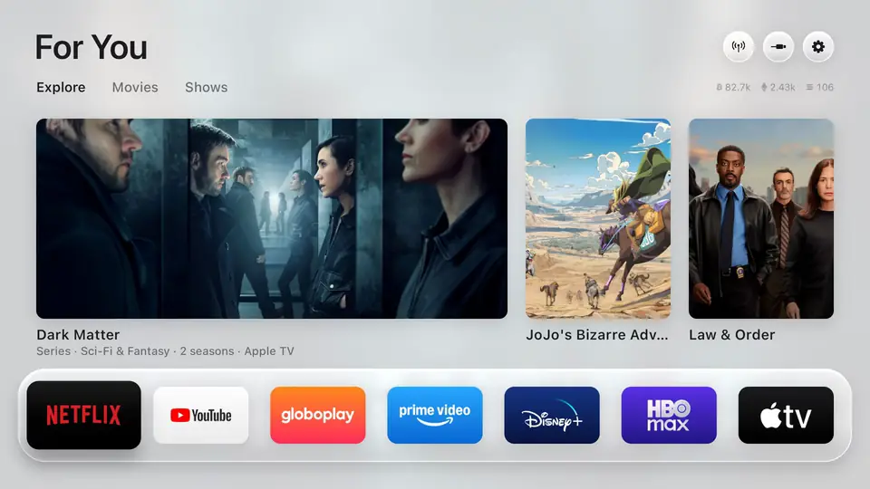

# CouchCloud

**Your own cloud, for the couch.** Turn the laptop you already own into a home media server with [Jellyfin](https://jellyfin.org): your own
films, home videos and video courses, with posters and descriptions, playing on your TV, phone and browser,
with "continue watching" shared between them. Free, open source, no ads, no account in the cloud, and nothing
leaves your home network.

CouchCloud is the setup I use on a Windows 11 laptop with a TCL Google TV. It took an evening to figure out;
this README is the short version, with scripts for the two parts Windows makes awkward (running Jellyfin as a
service and opening the firewall).

## What you need

- A Windows 10 or 11 laptop or PC that can stay on while you watch (set *Sleep → Never* when plugged in).
- Your videos in folders on it (see [How to name files](#how-to-name-files)).
- A TV with the Jellyfin app: Google TV / Android TV, Fire TV, LG webOS, Samsung Tizen, Apple TV, Roku, or
  a browser.
- Everything on the same Wi-Fi.

## 1. Install Jellyfin

1. Download **Jellyfin Server for Windows** from <https://jellyfin.org/downloads/server> and run the installer.
2. Open <http://localhost:8096> in the laptop's browser and follow the setup wizard: create your user and
   password, then add your first library (*Movies* → the folder with your films).

If the wizard gets stuck after a page refresh (the browser drops out of it), open these pages directly:
<http://localhost:8096/web/#/wizarduser.html> for the user, <http://localhost:8096/web/#/wizardfinish.html>
to finish. If a library shows "Nothing here" after you add it, open *Dashboard → Libraries → ⋮ → Scan
library* once; the first scan sometimes stops at the top folder.

## 2. Let other devices in

Windows blocks incoming connections by default. Two things must be true: your Wi-Fi is marked **Private**
(*Settings → Network & internet → Wi-Fi → your network → Network profile type → Private*), and Jellyfin's port
is allowed through the firewall. In an **administrator PowerShell** (Start → type PowerShell → right-click →
Run as administrator):

```powershell
powershell -ExecutionPolicy Bypass -File .\scripts\Allow-JellyfinFirewall.ps1
```

It adds one rule, TCP 8096, for Private networks only: on café or office Wi-Fi the port stays closed. Add
`-MakeNetworkPrivate` to also mark the current network Private.

Find the laptop's address with `ipconfig` (*IPv4 Address*, something like `192.168.1.47`). Other devices
reach Jellyfin at `http://<that address>:8096`.

## 3. Make Jellyfin start at boot

By default Jellyfin's Windows build starts from a tray icon, which means it only runs once someone logs in.
After a restart for an update, the laptop sits at the login screen and the TV finds nothing. Running
Jellyfin as a Windows service fixes that: it starts with the machine, and Windows restarts it if it crashes.

Jellyfin 10.9 and newer have no `--service` option of their own, so a plain `sc create` fails with error 1053.
The installer ships a small wrapper for exactly this (`nssm.exe`, in Jellyfin's folder), and the script
uses it:

```powershell
powershell -ExecutionPolicy Bypass -File .\scripts\Install-JellyfinService.ps1
```

It stops the tray-started copy, registers the service **Jellyfin Server** with your existing settings folder
(`C:\ProgramData\Jellyfin\Server`, so nothing about your libraries changes), starts it and waits until it
answers. The tray icon keeps working: once the service exists it controls the service instead of starting
its own copy. Safe to run twice; `-Uninstall` removes the service again.

Afterwards: `Start-Service JellyfinServer`, `Stop-Service JellyfinServer`, `Get-Service JellyfinServer`.

## 4. The TV and the phone

Install **Jellyfin** from the TV's app store (on Google TV it's `org.jellyfin.androidtv` in the Play Store),
and *Jellyfin* from the Play Store or App Store on the phone. Both usually find the server by themselves; if
not, type `http://<laptop address>:8096`. Log in with the user you created.

The TV app has no admin screens: libraries, users and settings are managed from a browser or the phone app
(☰ → *Dashboard*).

## How to name files

Jellyfin matches films to a movie database by name and year, and is fussy about layout:

```
D:\Movies\
  Big Buck Bunny (2008)\
    Big Buck Bunny (2008).mp4
  October Sky (1999)\
    October Sky (1999).mkv
    October Sky (1999).srt
```

One folder per film, `Name (Year)`, with the video (and subtitles) directly inside. A film in a folder full of
extras, or a video two folders deep, often doesn't show up. Series go in a *Shows* library as
`Show Name\Season 01\Show Name S01E01.mkv`.

### Video courses, lectures, home videos

For folders you want shown **as they are** (courses with numbered lessons, recordings, family videos) create a
library of type **Home Videos and Photos**. It keeps your folder tree, skips the movie-database lookup, sorts by
file name, and every folder gets a **▶ Play All** button that plays its videos in order, one after another.
For example:

```
D:\Learning\
  Essence of calculus\
    01 - The Essence of Calculus.mkv
    02 - The paradox of the derivative.mkv
```

Name files with a number first so the order is right. For big folders (thousands of videos), untick *Enable
photos* and leave *trickplay* and *chapter image* extraction off when you create the library, or the laptop
will stay busy for hours making thumbnails.

### Where did my new film go?

The *Recently Added* row hides anything already marked **watched**. Skipping to the end of a video marks it
watched; open the title and toggle the ✓ to put it back.

## Changing or removing folders

*Dashboard → Libraries → ⋮ on the library → Manage library*. A path can't be edited in place: remove it with
the 🗑 next to it and add the new one with **+**. Removing a path or a library never deletes files.

## Watching away from home

Don't forward ports on your router: an exposed Jellyfin or an exposed laptop is how people get hacked.
Install [Tailscale](https://tailscale.com) (free for personal use) on the laptop and on your phone or TV,
sign in with the same account on both, and the laptop's Tailscale address works from anywhere as if you were
on the home Wi-Fi, with nothing opened to the internet.

## Optional: manage the laptop from another computer

`scripts/Enable-RemoteAdmin.ps1` turns on Windows' built-in OpenSSH server, allows it on Private networks
only, and installs one public key, so you (or a tool like Claude Code on another machine) can run commands on
the laptop without sitting at it. It's a door into an administrator account: only do this on your own
network, keep it key-only (the script disables password login), and remove it with `-Disable` when you're
done.

## The TV side: Free My TV

CouchCloud's library is only half of the living-room setup. The other half is the TV's home screen. Stock Google TV
and Android TV home screens are ads and sponsored rows; [Free My TV](https://github.com/simbasjungles/free-my-tv) replaces
them with a clean, fast home screen you draw yourself: your apps (Jellyfin first), the weather, what's trending, and a
screensaver of film stills. It's a plain Android app in Java, built without Gradle, and it switches back to the stock
home screen in one tap.



[`free-my-tv/`](free-my-tv/) is my customized copy of it (MIT, attribution kept), with the changes I made for my own TV on
top of upstream:

- **Picks that learn.** Cards for films and shows from TMDB, with *Watched*, *Add to watchlist* and *Remove* verdicts
  that sync to the TMDB account, so ratings survive a reinstall and feed the recommendations.
- **Continue Watching** across apps, read from the TV's own media sessions.
- **Voice search** through the TV's speech recognizer, falling back to Google's.
- **Indian streaming apps** (JioHotstar, ZEE5, SonyLIV, Sun NXT, aha) mapped to TMDB's providers, and titles that only
  the stream address identifies matched by name.
- A crisp **focus ring** on every tile, 60 fps on a 1080p TCL.

Build and install instructions are in [`free-my-tv/README.md`](free-my-tv/README.md). Put Jellyfin on the shelf
(*Free My TV → Shelf*) and the TV turns on into your own library.

## Cheaper than buying a server

A Raspberry Pi plus a big disk costs more than people expect, can't transcode 4K, and needs a powered USB
hub. The laptop you have is free. If it has to go back to being a laptop: an old laptop or desktop with
Linux, or a used office mini PC (Dell OptiPlex Micro, Lenovo ThinkCentre Tiny, HP EliteDesk Mini with an
Intel i5) for the price of a Pi kit, is faster, quieter and transcodes with the Intel GPU.

## License

MIT. CouchCloud is an independent guide; Jellyfin is a trademark of the Jellyfin project.
